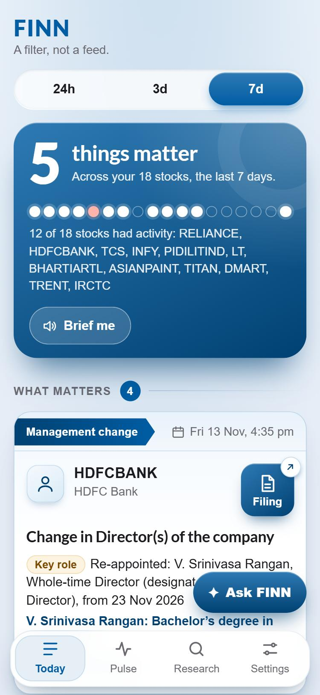
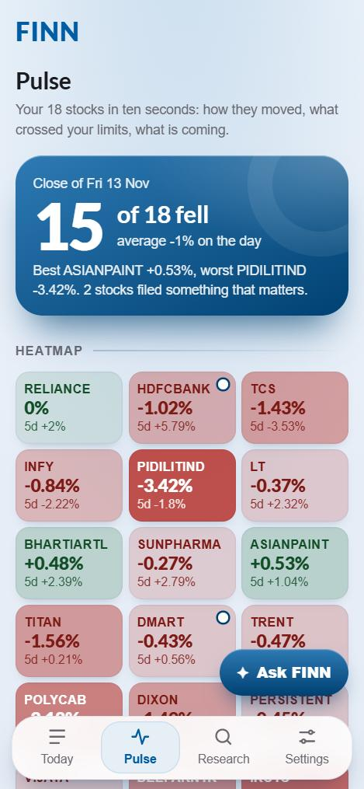
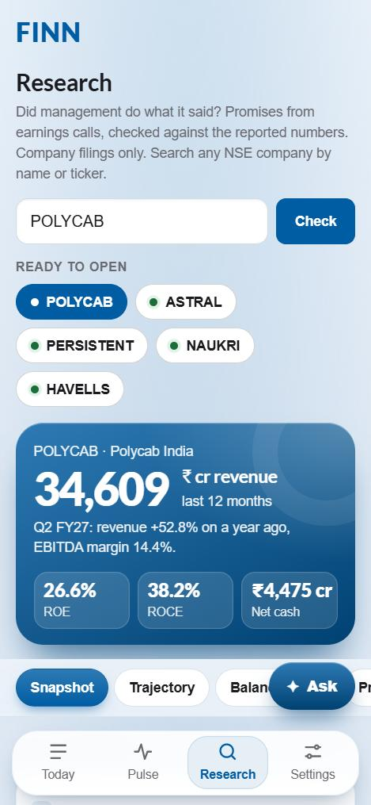
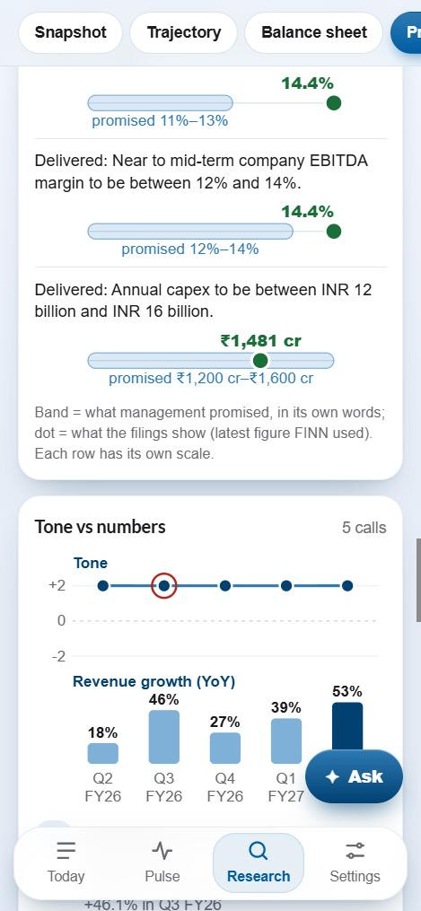
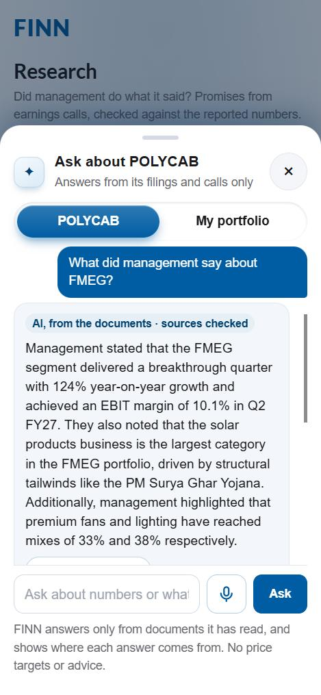
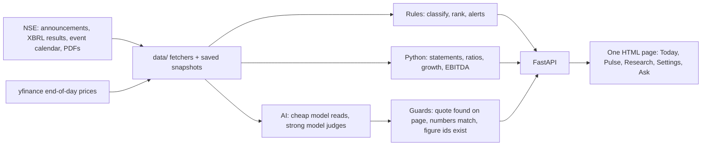

# FINN: a filter, not a feed

A mobile-first research agent for a long-term stock investor, built for the ENAM Holdings AI Engineer challenge.

- **Try it (open on a phone):** https://finn-viku.onrender.com. Free hosting: the first open can take ~30 s to wake.
- **Writeup:** [`WRITEUP.md`](WRITEUP.md) · **How it was built:** [`build-history/`](build-history/) · **Every decision:** [`DECISIONS.md`](DECISIONS.md)

> **Point of view: "Glance, triage, ask."** Pulse is a ten-second glance at 18 stocks. Today is a two-minute triage of what changed. An Ask box answers questions, and only from documents FINN has read, with the source one tap away. Every number and quote can be traced to a filing page.

| Today | Pulse | Research | Narrative vs numbers | Ask |
|---|---|---|---|---|
|  |  |  |  |  |

## What it does

**Push (the app tells you what changed)**
- **Windowed digest:** 24 h / 3 d / 7 d across 18 NSE stocks. Each filing is sorted by one test: *would a long-term fund manager change a hold/buy/sell view because of this?* High = a card, Medium = a one-liner, the rest collapses into "Routine", each with its reason.
- **Alerts you configure:** price move and volume limits, and the types of filing you care about. Settings shows how many alerts your limits would have fired over the last 7 sessions.
- **Results card:** Revenue, EBITDA, PBT and PAT with QoQ and YoY. Every figure is found on the filing page, and growth is computed by FINN's code, not by AI.
- **Management-change card:** who joined or left, where they came from, and whether the exit was planned or immediate, all checked against the filing's own text.
- **Since you last looked:** new filings are marked, and a results card shows what management promised that the quarter tests.

**Pull (you ask it to dig in)**, for **any NSE ticker** (POLYCAB, PERSISTENT and ASTRAL are precomputed)
- Business snapshot, financial snapshot, trajectory, balance sheet and cash (working-capital clock, profit-to-cash bridge).
- **Narrative vs numbers:** each promise from the earnings calls, quoted word for word and judged against the filed figures; a promised-vs-delivered chart; a credibility meter; management's tone against the growth that followed.
- Bull vs bear, each point with a verified source.

**Ask FINN:** per stock, per filing, or across the portfolio; by typing or voice. It refuses advice, price targets and anything it cannot source.

## How it works



**Who decides what** (the brief's "pick the right tool for each step")

| Step | Done by | Why |
|---|---|---|
| Classify filings, rank, price/volume alerts | Rules | Free, instant, auditable |
| Statements, ratios, growth, margins, EBITDA, tax rate, capex | Python, from NSE XBRL | Exact; no model call |
| Read a results PDF, a management filing, a profile, tone | Cheap model (`gemini-3.5-flash-lite`) | Bulk copying; Python then verifies every item |
| Extract promises, judge promise vs numbers, bull/bear | Strong model (`gemini-3.5-flash`) | Needs reasoning; Python checks the verdicts |
| Quota used up or overloaded | Backup model (`gemini-3.1-flash-lite`), labelled on screen | The demo keeps running |
| Plain number questions in Ask | Python | Never touches a model |

**Guards on AI output:** a quote is shown only if found on the cited page; a number only if found on the cited filing page; a promise verdict is overridden by Python when it contradicts the figures (e.g. annual capex judged on half-year spend becomes "Too early"). Anything unverified is dropped, never shown.

## Cost and efficiency

Free tiers only (₹0). Each document is read by AI once and the answer is cached (SQLite), so repeat opens cost nothing. Only the relevant pages are sent to a model (chunking).

| Tier | Answers kept | Tokens in / out |
|---|---|---|
| Cheap (`gemini-3.5-flash-lite`) | 238 | 792 k / 135 k |
| Strong (`gemini-3.5-flash`) | 51 | 252 k / 148 k |
| Rules and Python (alerts, ranking, all statements) | n/a | 0 |

## Run it

```bash
py -m pip install -r requirements-dev.txt
py -m uvicorn api:app --port 8000      # open http://localhost:8000 (put GEMINI_API_KEY in .env for live AI)
py -m pytest -q                        # 243 tests, no network
```

Useful scripts: `py refresh_snapshot.py` (freeze prices, filings, cards), `py run_research.py POLYCAB --save` (rebuild one research file), `py run_mgmt_enrich.py` (management-card backgrounds), `py smoke_test_llm.py` (check the models respond). Without a key, everything precomputed still works.

## Decision map

Full reasoning, with the options rejected, is in [`DECISIONS.md`](DECISIONS.md) (D-001 to D-109).

| Theme | What was decided | IDs |
|---|---|---|
| Scope and POV | Filter, not feed; thin but working beats broad but broken | D-043, D-057 |
| Sorting | Rules not AI; every High filing is a card, uncapped | D-015, D-065 |
| Data | NSE API (BSE blocks scripts); yfinance for end-of-day prices; snapshots as fallback | D-063, D-064 |
| Numbers | Python does all arithmetic; EBITDA computed and labelled; banks have their own lines | D-048, D-054 |
| Statements | NSE XBRL instead of reading PDFs, reconciled against printed filings | D-093, D-103 |
| Trust | A receipt on every claim; unverified quotes dropped; AI-written sentences must carry a found passage | D-041, D-083, D-094 |
| Promise tracker | Python facts, one verdict call, Python guards on verdicts, segment/capex/tax facts | D-080 to D-086, D-105 |
| Models | Free Gemini only: cheap for bulk, strong for reasoning, labelled backup | D-060, D-061, D-088, D-106 |
| Look | ENAM colours and type, hero card, hand-built SVG charts | D-074, D-096 |
| Interaction | Brief me, then Pulse, Copilot, Ask FINN, voice | D-052, D-091, D-098, D-107, D-108 |
| Push refinements | New markers, why-buried, live limit preview, management background, promises on results | D-099, D-109 |
| Research search | Typeahead over every NSE company, recents, results kept on the phone | D-100 |
| Process | One-block-at-a-time loop; freeze, then fixes only | D-078, D-090 |

## Glossary

- **NSE / XBRL:** the exchange / machine-readable results data companies file with it.
- **Revenue, EBITDA, PBT, PAT:** sales; operating profit before interest, tax, depreciation; profit before tax; profit after tax. **QoQ / YoY:** vs last quarter / vs the same quarter a year ago.
- **ROE / ROCE:** profit per rupee of shareholders' money / of all capital employed.
- **D/E:** debt ÷ equity. **FCF:** cash left after capex. **Cash conversion:** operating cash ÷ profit.
- **Working-capital cycle:** days cash sits in stock and customers' hands, minus days suppliers wait.
- **Guidance / promise:** what management said it expects; FINN quotes it and judges it against the filings.
- **Receipt:** the quote or figure, and its page, behind a claim. **Primary source:** a document from the company itself (filings, transcripts), not news or broker notes.
- **Snapshot:** a saved copy of fetched data so the demo works if a source is down.
- **Backup model:** the cheaper model used when the strong one is out of free quota; the screen says so.

## Repo map

`api.py` the API · `data/` fetchers (prices, filings, XBRL, events, symbols) · `engine/` rules, ranking, statements, research, Ask, Pulse · `web/index.html` the whole front end · `snapshot/` saved data · `tests/` · `design/` look and screens · `plan_revamp_v2/`, `plan_revamp_v3/` the review against the brief and the routing plan · `build-history/` the AI conversations.

## What is not here

Real push notifications and intraday data (end-of-day only); logins (settings live in the browser); annual-report reading; OCR for scanned filings; bank asset-quality metrics; adding or removing portfolio stocks. See `WRITEUP.md` for the next steps.
